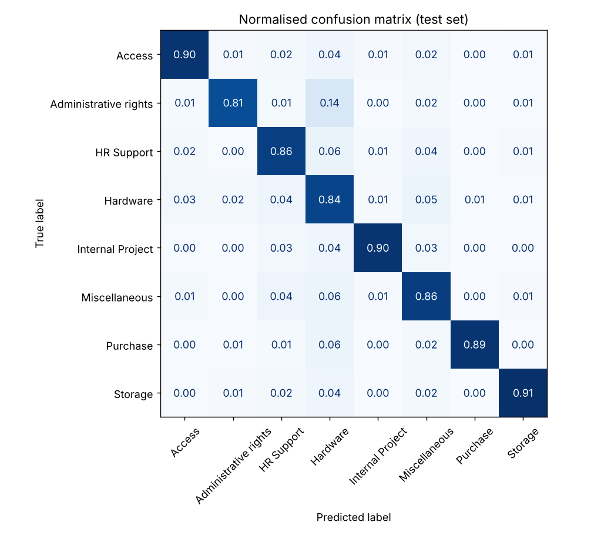

# IT Support Ticket Routing (NLP)

Multiclass text classifier that routes helpdesk tickets to the right queue, with a confidence score and a human-triage fallback. Built for the **Infosys (AI & Automation Division) brief, Task 2: NLP for Customer Service Ticket Routing**.

**Live app:** _add your Streamlit link here_

## Objective
Reduce misrouted tickets in a service desk. Audience: helpdesk teams and service managers. Output: predicted queue + confidence, and an auto-route / manual-triage decision.

## Data overview
- `data/tickets.csv`: 47,837 IT support tickets (`Document` = pre-processed ticket text, `Topic_group` = queue). Source: Kaggle IT Service Ticket Classification dataset (`all_tickets_processed_improved_v3`).
- 8 queues: Hardware (28.5%), HR Support (22.8%), Access (14.9%), Miscellaneous (14.8%), Storage (5.8%), Purchase (5.2%), Internal Project (4.4%), Administrative rights (3.7%).
- No missing values or duplicates; median ticket length about 26 words, long tail up to 981.

## Process
1. **Cleaning:** drop duplicates/nulls, lower-case, remove URLs, emails, digits and punctuation (`src/preprocess.py`, shared by training and the app).
2. **EDA:** class balance, length distributions, top words per queue, queue vocabulary similarity.
3. **Features:** TF-IDF unigrams + bigrams (`min_df=3`, `max_df=0.9`, sublinear TF).
4. **Models:** Complement Naive Bayes, Linear SVM, Logistic Regression (stratified 80/20 split, class-balanced weights).
5. **Selection:** Logistic Regression, tied with the SVM on accuracy but it provides probabilities for the confidence threshold.

## Results (test set, 9,568 tickets)
| Model | Accuracy | Macro F1 |
|---|---|---|
| Complement Naive Bayes | 0.816 | 0.803 |
| Linear SVM | 0.865 | 0.865 |
| **Logistic Regression (final)** | **0.865** | **0.866** |

Confidence threshold trade-off: at 0.7, about 72% of tickets are auto-routed at about 95% accuracy; at 0.9, about 51% at about 98.5%. Most remaining errors are between HR Support, Hardware and Miscellaneous.



## Project structure
```
data/tickets.csv            dataset
notebooks/ticket_routing.ipynb   full analysis (cleaning, EDA, modeling, evaluation)
src/preprocess.py, train.py      cleaning function and training script
models/ticket_classifier.joblib  trained pipeline
reports/                         metrics, comparison table, figures
app.py                           Streamlit app
```

## Run locally
```bash
pip install -r requirements.txt
python src/train.py          # optional: retrains and overwrites the model
streamlit run app.py
```

## Deploy (Streamlit Community Cloud)
1. Push this repo to GitHub (the model file is about 6 MB, fine for GitHub).
2. Go to share.streamlit.io, sign in with GitHub, click **New app**.
3. Pick the repo, branch `main`, main file `app.py`, then **Deploy**.
4. Paste the live URL at the top of this README and add 1 or 2 screenshots of the app.

## Next steps
BERT / sentence-transformer embeddings, hyper-parameter tuning, label cleaning, and feeding human-triaged tickets back as training data.
